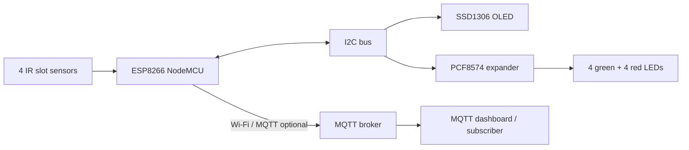

# IoT Smart Parking Management System

An ESP8266-based four-slot parking monitor. Four infrared sensors detect slot occupancy; an I2C PCF8574 expander drives red/green indicators, an OLED displays availability, and optional MQTT publishes the live state to a broker.

> **Verification honesty:** This repository includes firmware, documentation, sample data, automated software checks and cloud build configuration. Unless explicitly recorded in a dated hardware test report, physical sensor wiring, vehicle detection, OLED operation, Wi-Fi connectivity and broker delivery are **not verified**. Simulated tests are not physical tests.

## Project objectives
- Detect occupancy independently for four parking bays.
- Show occupied/vacant counts locally on an SSD1306 OLED.
- Illuminate one green or red indicator per bay through a PCF8574 I/O expander.
- Optionally publish a retained JSON status message using MQTT.
- Keep configuration and credentials out of committed source code.

## System architecture


## Hardware inventory

| Item | Qty | Purpose |
|---|---:|---|
| ESP8266 NodeMCU | 1 | Controller and Wi-Fi |
| Digital IR obstacle sensors | 4 | Slot occupancy input |
| SSD1306 I2C OLED, 128x64 | 1 | Local status display |
| PCF8574 I/O expander module | 1 | Eight LED outputs |
| Green LEDs | 4 | Vacant slot indication |
| Red LEDs | 4 | Occupied slot indication |
| LED resistors (typically 220–330 ohm) | 8 | Current limiting |
| Regulated 5 V supply / USB | 1 | Power source |
| Breadboard, jumpers | as needed | Prototyping |

**Electrical note:** ESP8266 GPIO is 3.3 V logic and is not 5 V tolerant. Ensure sensor outputs are 3.3 V-compatible or level-shifted. Check the PCF8574 module's supply and I2C pull-ups; do not pull SDA/SCL up to 5 V. Power LEDs from a suitable driver arrangement and verify expander sink/source current limits before connecting them.

## Pin and I2C map

| Function | NodeMCU pin | ESP8266 GPIO |
|---|---|---:|
| I2C SCL | D1 | 5 |
| I2C SDA | D2 | 4 |
| Slot 1 IR OUT | D5 | 14 |
| Slot 2 IR OUT | D6 | 12 |
| Slot 3 IR OUT | D7 | 13 |
| Slot 4 IR OUT | D0 | 16 |

I2C devices share the bus: OLED default address commonly 0x3C; PCF8574 address commonly 0x20 (confirm address jumpers/module variant). PCF8574 outputs P0–P3 are green indicators for slots 1–4; P4–P7 are red indicators for slots 1–4. Firmware writes one output byte with only the appropriate indicator enabled per slot.

## Firmware setup

1. Install VS Code and PlatformIO IDE, or install PlatformIO Core.
2. Clone this repository.
3. Copy `include/secrets.example.h` to `include/secrets.h` and enter local Wi-Fi/MQTT settings if required.
4. Review `include/project_config.h` for sensor polarity, I2C addresses and MQTT topic.
5. Build the default firmware:
   ```sh
   pio run -e nodemcuv2
   ```
6. Build with MQTT enabled:
   ```sh
   pio run -e nodemcuv2-mqtt
   ```
7. Upload only after checking your actual board, wiring and power:
   ```sh
   pio run -e nodemcuv2 -t upload
   ```

The default build has MQTT disabled and does not require Wi-Fi credentials. For MQTT, set `WIFI_SSID`, `WIFI_PASSWORD`, `MQTT_HOST`, and optionally port/user/password in the untracked `secrets.h`.

## MQTT interface

When compiled with MQTT enabled, the device publishes JSON to `parking/site-a/status` by default. Example:
```json
{"device":"smart-parking-01","slots":[{"slot":1,"occupied":false},{"slot":2,"occupied":true},{"slot":3,"occupied":false},{"slot":4,"occupied":true}],"available":2,"occupied":2}
```
The payload is published periodically and after a detected state change. Configure broker access securely; do not commit credentials or expose an unauthenticated broker to the public internet. See [docs/mqtt.md](docs/mqtt.md).

## Repository structure
- `src/main.cpp` — application firmware
- `include/project_config.h` — pin, polarity and device settings
- `include/secrets.example.h` — safe configuration template
- `data/sample_slots.csv` — example synthetic occupancy records
- `tests/test_sample_data.py` — automated data validation
- `docs/architecture.md` — design and data flow
- `docs/wiring.md` — connection and electrical guidance
- `docs/testing.md` — verification plan and current evidence
- `docs/research.md` — technical references and design rationale
- `.github/workflows/ci.yml` — automated checks and firmware builds

## Safety and limitations
This is an educational prototype, not a certified parking, access-control, life-safety or traffic-management system. IR sensors can be affected by alignment, sunlight, surface reflectivity and environmental conditions. A real deployment needs enclosure design, robust sensing, fault detection, power protection, network security, calibration and supervised field testing. Do not use this prototype to control barriers or make safety-critical decisions.

## Current project status
- Source and documentation: prepared in this repository.
- Automated validation: performed by GitHub Actions; see the Actions tab.
- Physical prototype validation: pending unless supported by a separate dated test record.
- MQTT live broker test: pending unless supported by a separate dated test record.

## License
MIT. See [LICENSE](LICENSE).


## Evaluator guide

See [docs/evaluator-guide.md](docs/evaluator-guide.md) for the review sequence, reproducible software checks and physical-validation limitations.