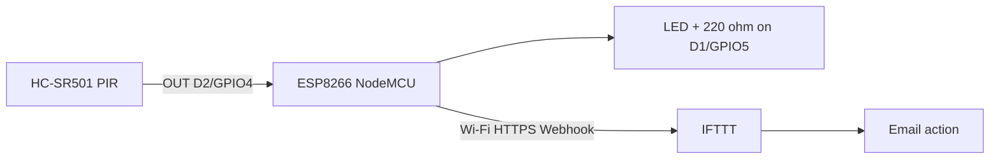

# Project 04 — System Architecture
The HC-SR501 PIR module provides a digital motion signal to ESP8266 NodeMCU D2/GPIO4. The controller turns an LED on D1/GPIO5 on while motion is active. On a rising motion edge it sends an HTTPS request to the IFTTT Webhooks event configured to send an email. A 60-second cooldown suppresses repeated alerts after a successful response.

This is an educational notification prototype, not a certified alarm. Email delivery must be confirmed independently.
